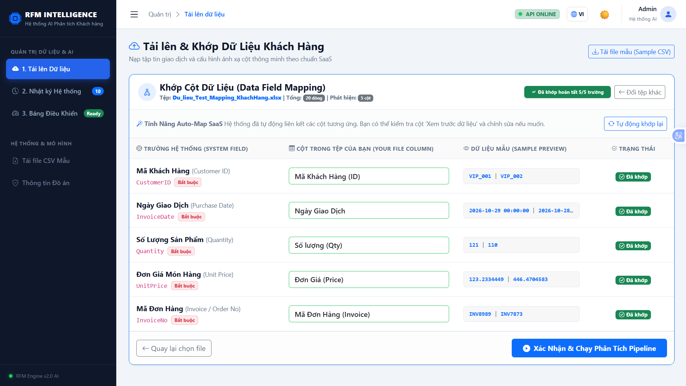
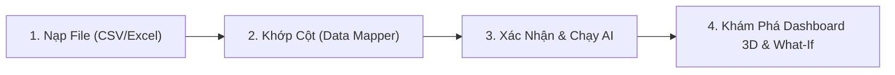
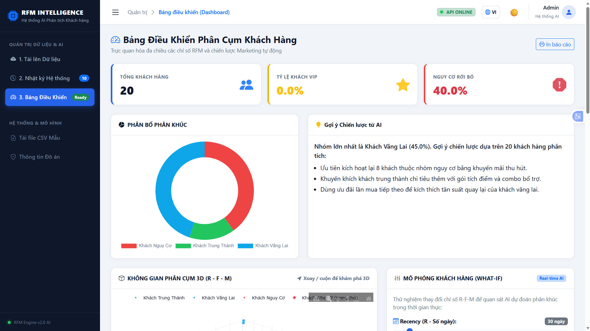
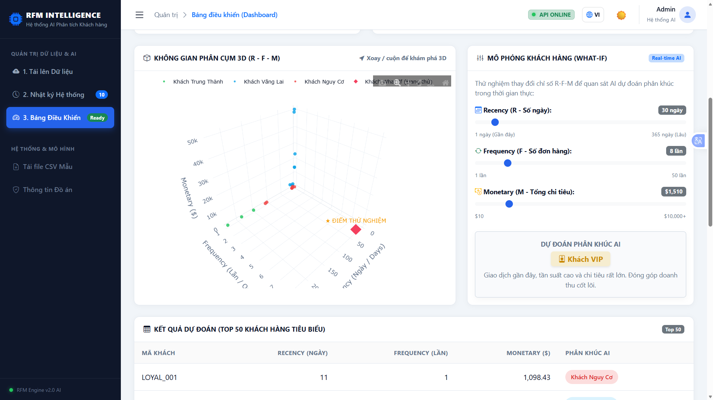
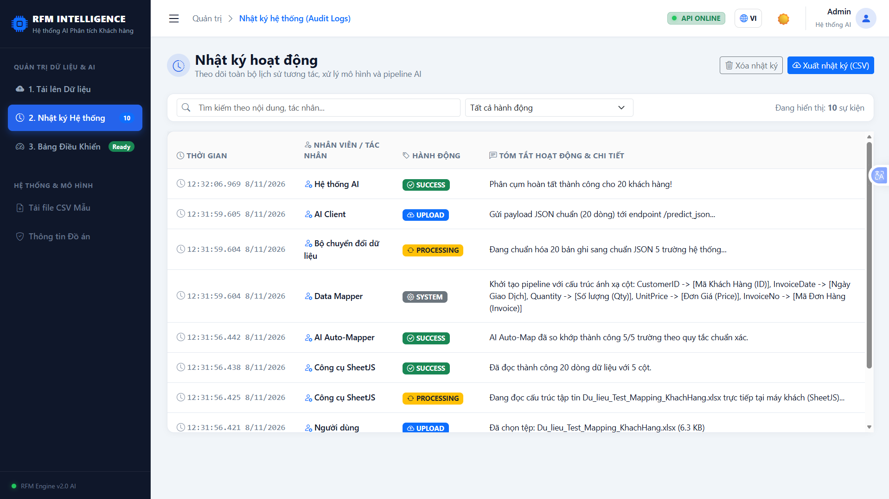
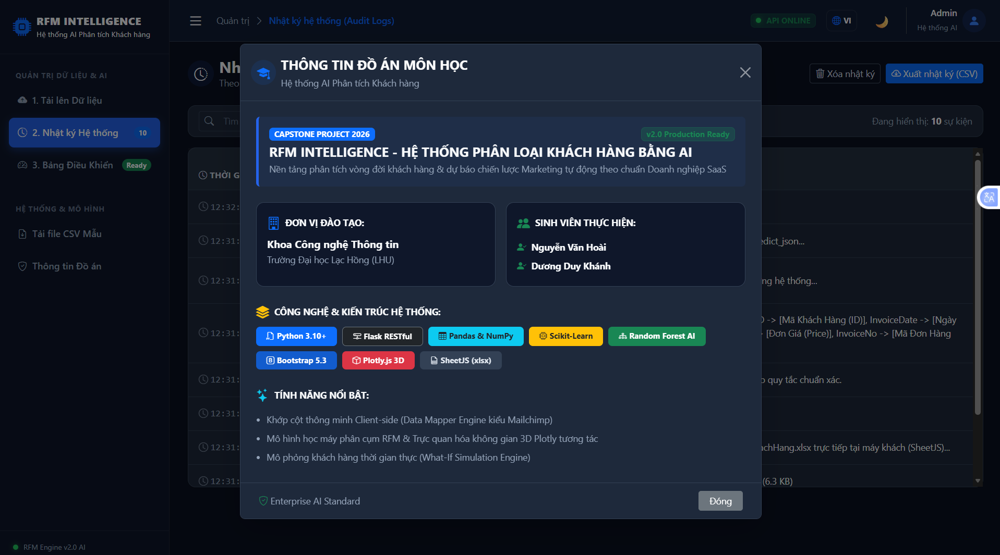

<div align="center">

# 🚀 RFM INTELLIGENCE
### AI-Powered Enterprise Customer Segmentation & Lifecycle Analytics System
**Hệ Thống Phân Loại & Phân Tích Vòng Đời Khách Hàng Bằng Trí Tuệ Nhân Tạo**

[](https://www.python.org/)
[](https://flask.palletsprojects.com/)
[](https://scikit-learn.org/)
[](https://getbootstrap.com/)
[](https://plotly.com/)
[](https://opensource.org/licenses/MIT)
[]()

<br/>

*Đồ án tốt nghiệp Chuyên ngành Công nghệ Phần mềm & Trí tuệ Nhân tạo*  
**Khoa Công nghệ Thông tin — Trường Đại học Lạc Hồng (LHU)**

---

<!-- Thay thế link ảnh chụp màn hình dự án vào bên dưới -->
<p align="center">
  
</p>

</div>

<br/>

## 📖 1. Giới Thiệu Dự Án (Overview)

Trong kỷ nguyên thương mại điện tử và bán lẻ đa kênh, việc thấu hiểu hành vi khách hàng là yếu tố sống còn để tối ưu hóa chi phí Marketing (CAC), gia tăng giá trị trọn đời (CLV) và giảm thiểu tỷ lệ rời bỏ (Churn Rate).

**RFM INTELLIGENCE** là giải pháp phần mềm dạng **SaaS (Software-as-a-Service)** hiện đại, kết hợp giữa mô hình kinh tế định lượng kinh điển **RFM (Recency, Frequency, Monetary)** và thuật toán **Machine Learning (K-Means Clustering & Random Forest Classifier)**. Hệ thống cho phép doanh nghiệp tự động phân tích lịch sử giao dịch thô, tự động nhận diện ánh xạ cột thông minh, phân cụm tệp khách hàng thành các nhóm hành vi chuyên biệt (VIP, Loyal, Potential, At Risk, Churned) và đề xuất chiến lược tiếp thị tự động theo thời gian thực.
<div align="center">
  
</div>
---

## ✨ 2. Tính Năng Nổi Bật (Key Features)

### 🧩 1. Smart Data Mapper UI (Chuẩn SaaS Mailchimp)
- **Client-Side Instant Parsing:** Sử dụng thư viện **SheetJS (xlsx.js)** để đọc nhanh dòng tiêu đề và 100 dòng dữ liệu mẫu ngay tại máy khách trong vòng **< 100ms** mà không làm nghẽn băng thông server.
- **Thuật toán AI Auto-Map từ vựng (Regex & Word-Boundary):** Tự động nhận diện và ghép nối các cột Tiếng Việt/Tiếng Anh (ví dụ: *"Mã khách hàng"* $\rightarrow$ `CustomerID`, *"Đơn giá"* $\rightarrow$ `UnitPrice`, *"Ngày giao dịch"* $\rightarrow$ `InvoiceDate`). Áp dụng cơ chế **Biên từ (`hasWord`)** và **Điểm phạt tiêu cực (-1000)** giúp loại bỏ hoàn toàn việc bắt nhầm chuỗi con.
- **Interactive Live Preview:** Xem trước dữ liệu thực tế ngay trên từng dòng ánh xạ trước khi gửi lên AI Pipeline.

### 🌐 2. Deep i18n & Adaptive UI Theme
- **Chuyển đổi Đa ngôn ngữ (VI / EN):** Tích hợp từ điển nội suy `i18n.js` động, dịch 100% mọi thành phần từ menu, nút bấm, thông báo Toastify, đến giải thích thuật ngữ chiến lược.
- **Dark / Light Mode Tự Động:** Hệ thống CSS Variables tương phản cao theo chuẩn **WCAG**, bảo vệ mắt người dùng khi làm việc ban đêm và tự động lưu trạng thái vào `localStorage`.

### 🌌 3. Phân Cụm Đa Chiều 3D (3D Cluster Scatter Space)
- Tích hợp không gian tọa độ 3 chiều tương tác thông qua thư viện **Plotly.js**:
  - **Trục X:** Recency (Số ngày kể từ lần mua gần nhất).
  - **Trục Y:** Frequency (Tổng số lần phát sinh đơn hàng).
  - **Trục Z:** Monetary (Tổng chi tiêu tích lũy).
- Cho phép người dùng tự do **xoay 360°, phóng to/thu nhỏ, rê chuột xem metadata từng khách hàng**.

### 🎛️ 4. Bộ Mô Phỏng Thời Gian Thực (What-If Simulation Engine)
- Cung cấp 3 thanh trượt tham số động cho R, F, M.
- Cho phép đội ngũ Marketing giả lập ngay lập tức: *"Nếu khách hàng này tăng chi tiêu thêm \$1,000 và mua cách đây 5 ngày, thuật toán AI sẽ xếp họ vào nhóm nào?"*

### 📋 5. Nhật Ký Hoạt Động Doanh Nghiệp (System Audit Logs)
- Giao diện bảng quản trị doanh nghiệp chuyên nghiệp (phong cách Admin Portal).
- Ghi nhận chi tiết từng mốc thời gian, tác nhân (Hệ thống AI, SheetJS, Client, Người dùng), kèm Badge trạng thái màu sắc (`SYSTEM`, `UPLOAD`, `PROCESSING`, `SUCCESS`).
- Hỗ trợ **Bộ lọc theo hành động**, **Tìm kiếm theo từ khóa realtime** và nút **Xuất báo cáo sang CSV**.

---

## 🏗️ 3. Kiến Trúc Cấu Trúc Thư Mục (Modular Architecture)

Dự án được xây dựng theo chuẩn mực **Software Engineering** với kiến trúc module hóa: toàn bộ các trang giao diện phức tạp được tách thành các Jinja2 Components độc lập (đảm bảo không file nào vượt quá 150 dòng mã nguồn):

```text
RFM_Web_App/
│
├── 📁 models/                                   # Lưu trữ mô hình AI đã huấn luyện
│   ├── 📄 rfm_classifier_model.pkl              # Mô hình phân loại khách hàng (Random Forest)
│   └── 📄 rfm_scaler.pkl                        # Chuẩn hóa độ lệch dữ liệu (StandardScaler)
│
├── 📁 templates/                                # Giao diện Jinja2 Components (Clean Code)
│   ├── 📄 index.html                            # Master Shell (Rút gọn ~50 dòng, gọi components)
│   └── 📁 components/                           # Các component giao diện phân rã độc lập
│       ├── 📄 navbar.html                       # Sidebar điều hướng + Topbar quản trị + Theme
│       ├── 📄 tab_upload.html                   # Tab 1: Khung Upload & Bảng Data Mapper UI
│       ├── 📄 tab_logs.html                     # Tab 2: Bảng Nhật ký Hoạt động (Audit Logs)
│       ├── 📄 tab_dashboard.html                # Tab 3: KPI Metrics, Biểu đồ 3D & What-If
│       └── 📄 modal_info.html                   # Bootstrap Modal thông tin đề tài tốt nghiệp
│
├── 📁 static/                                   # Tài nguyên tĩnh phía Client
│   ├── 📁 css/
│   │   └── 📄 style.css                         # CSS Grid 2 chiều, Responsive & Dark Theme
│   ├── 📁 js/
│   │   ├── 📄 i18n.js                           # Bộ từ điển song ngữ & cơ chế Deep Translation
│   │   ├── 📄 ui.js                             # Logic giao diện, Dark Mode & Render Audit Logs
│   │   └── 📄 api.js                            # SheetJS, Auto-Map, Plotly 3D, What-If real-time
│   └── 📄 sample_rfm.csv                        # Tập tin dữ liệu mẫu cho khách hàng test thử
│
├── 📁 uploads/                                  # Thư mục đệm tiếp nhận dữ liệu tải lên
│
├── 📄 app.py                                    # Flask Backend RESTful Server & Routing
├── 📄 rfm_engine.py                             # Pipeline tiền xử lý RFM & Suy luận Machine Learning
├── 📄 requirements.txt                          # Danh sách các thư viện Python phụ thuộc
└── 📄 README.md                                 # Tài liệu dự án chuẩn mực
```

---

## 🛠️ 4. Công Nghệ Sử Dụng (Tech Stack)

| Lớp (Layer) | Công nghệ / Thư viện | Vai trò & Mục đích sử dụng |
| :--- | :--- | :--- |
| **Backend Core** | `Python 3.10+`, `Flask RESTful` | Xây dựng API Server, định tuyến `/predict` và `/predict_json`. |
| **Machine Learning** | `Scikit-Learn`, `Pandas`, `NumPy`, `Joblib` | Tiền xử lý dữ liệu giao dịch, chuẩn hóa `StandardScaler`, suy luận mô hình `Random Forest Classifier`. |
| **Frontend Framework** | `HTML5`, `CSS3 (CSS Grid)`, `Bootstrap 5.3` | Bố cục layout kiểu Admin Portal cao cấp, responsive đa thiết bị. |
| **Modular Templating** | `Jinja2 Components` | Phân rã mã nguồn HTML thành các khối chức năng nhỏ gọn (< 150 dòng). |
| **Client-side Computing** | `SheetJS (xlsx.js)` | Đọc và trích xuất cấu trúc file Excel/CSV siêu tốc ngay tại trình duyệt. |
| **Visualizations** | `Plotly.js 3D`, `Chart.js` | Biểu đồ không gian phân cụm 3D tương tác và biểu đồ tròn tỷ lệ phân khúc. |
| **UI Enhancements** | `Bootstrap Icons`, `Toastify.js` | Hệ thống biểu tượng giao diện và thông báo popup hiện đại. |

---

## 📊 5. Thuật Toán & Mô Hình Phân Khúc RFM

Hệ thống tính toán 3 chỉ số then chốt dựa trên dữ liệu giao dịch của từng khách hàng:
1. **Recency ($R$):** $R = \text{Ngày tham chiếu} - \max(\text{InvoiceDate})$ *(Số ngày khách chưa quay lại)*
2. **Frequency ($F$):** $F = \text{CountDistinct}(\text{InvoiceNo})$ *(Tổng số đơn hàng thành công)*
3. **Monetary ($M$):** $M = \sum (\text{Quantity} \times \text{UnitPrice})$ *(Tổng số tiền đóng góp)*

### Ma trận Nhãn phân khúc (Customer Segments):
* 🥇 **Khách VIP (VIP Customers):** Giao dịch gần đây, tần suất cao, tổng chi tiêu dẫn đầu doanh nghiệp $\rightarrow$ *Chiến lược: Chăm sóc đặc quyền, tri ân cá nhân hóa.*
* 🥈 **Khách Trung Thành (Loyal Customers):** Mua hàng đều đặn, gắn kết lâu năm $\rightarrow$ *Chiến lược: Tích điểm loyalty, upsell sản phẩm mới.*
* 🥉 **Khách Tiềm Năng (Potential Customers):** Chi tiêu tốt nhưng tần suất mua chưa đều $\rightarrow$ *Chiến lược: Gợi ý sản phẩm combo, khuyến mãi định kỳ.*
* 🌱 **Khách Hàng Mới (New Customers):** Vừa thực hiện đơn hàng đầu tiên $\rightarrow$ *Chiến lược: Email chào mừng, hướng dẫn trải nghiệm dịch vụ.*
* ⚠️ **Nguy Cơ Rời Bỏ (At-Risk Customers):** Đã rất lâu chưa quay lại dù từng mua nhiều $\rightarrow$ *Chiến lược: Voucher kích hoạt khẩn cấp, khảo sát lý do.*
* 💤 **Khách Rời Bỏ (Churned Customers):** Không hoạt động trong thời gian dài $\rightarrow$ *Chiến lược: Chiến dịch Re-engagement tiết kiệm chi phí.*

---

## ⚙️ 6. Hướng Dẫn Cài Đặt & Triển Khai (Installation)

### Yêu cầu tiên quyết:
- Đã cài đặt **Python 3.10 trở lên** ([Tải tại python.org](https://www.python.org/downloads/)).
- Đã cài đặt **Git** trên máy tính.

### Các bước cài đặt:

**Bước 1: Clone kho mã nguồn về máy**
```bash
git clone https://github.com/hoaideeptry/AI-Customer-Classification-System.git
cd RFM_Web_App
```

**Bước 2: Khởi tạo và kích hoạt môi trường ảo (Virtual Environment)**
* Trên Windows (PowerShell / Command Prompt):
```bash
python -m venv venv
.\venv\Scripts\activate
```
* Trên macOS / Linux:
```bash
python3 -m venv venv
source venv/bin/activate
```

**Bước 3: Cài đặt các gói thư viện phụ thuộc**
```bash
pip install -r requirements.txt
```

**Bước 4: Khởi chạy Web Server**
```bash
python app.py
```

Sau khi chạy thành công, mở trình duyệt web và truy cập vào đường dẫn:
```text
http://127.0.0.1:5000
```

---

## 🚀 7. Hướng Dẫn Sử Dụng Nhanh (Quick-Start Guide)



1. **Bước 1 (Chọn tệp):** Tại Tab **"1. Tải lên Dữ liệu"**, kéo thả tập tin lịch sử giao dịch (hoặc bấm nút *"Tải file mẫu (Sample CSV)"* để trải nghiệm ngay).
2. **Bước 2 (Khớp cột thông minh):** Hệ thống tự động mở giao diện **Data Mapper UI**. Thuật toán AI sẽ tự động chọn 5 cột tương ứng: `CustomerID`, `InvoiceDate`, `Quantity`, `UnitPrice`, `InvoiceNo`. Người dùng có thể kiểm tra dữ liệu xem trước và điều chỉnh nếu cần.
3. **Bước 3 (Phân tích AI):** Nhấn **"Xác Nhận & Chạy Phân Tích Pipeline"**. Client sẽ chuẩn hóa và gửi dữ liệu lên Flask API.
4. **Bước 4 (Khai thác kết quả):** 
   - Xem ngay 3 thẻ KPI tổng quan doanh nghiệp.
   - Xoay biểu đồ **3D Scatter Space** để quan sát trực quan sự phân bố của khách hàng.
   - Kéo các thanh trượt trong khung **"Mô phỏng Khách hàng (What-If)"** để thử nghiệm dự đoán phân khúc tức thời.
   - Sang Tab **"2. Nhật ký Hệ thống"** để kiểm tra lịch sử audit hoặc xuất báo cáo ra file CSV.

---

## 📸 8. Hình Ảnh Giao Diện Thực Tế (Screenshots)

<table align="center" width="100%">
  <tr>
    <td width="50%" align="center">
      <b>Data Mapper UI (Khớp cột SaaS)</b><br/>
      
    </td>
    <td width="50%" align="center">
      <b>Biểu đồ Không gian 3D Scatter (Plotly)</b><br/>
      
    </td>
  </tr>
  <tr>
    <td width="50%" align="center">
      <b>Bảng Nhật Ký Hoạt Động (Audit Logs)</b><br/>
      
    </td>
    <td width="50%" align="center">
      <b>Giao Diện Tối (Dark Mode UI)</b><br/>
      
    </td>
  </tr>
</table>

---

## 🎓 9. Thông Tin Tác Giả & Đơn Vị Đào Tạo

Đồ án được nghiên cứu và phát triển bởi nhóm sinh viên Khoa Công nghệ Thông tin — Trường Đại học Lạc Hồng:

* 🧑‍💻 **Nguyễn Văn Hoài**
  - Chuyên ngành: Công nghệ Thông tin
  - Trường: Đại học Lạc Hồng (LHU)
  - Vai trò: Phát triển Thuật toán Machine Learning, Data Pipeline & Backend RESTful API.
* 🧑‍💻 **Dương Duy Khánh**
  - Chuyên ngành: Công nghệ Thông tin
  - Trường: Đại học Lạc Hồng (LHU)
  - Vai trò: Thiết kế Kiến trúc Giao diện SaaS Frontend, Smart Data Mapper & Trực quan hóa 3D Plotly.

---

## 📄 10. Giấy Phép Sử Dụng (License)

Dự án này được phân phối dưới giấy phép **MIT License**. Bạn hoàn toàn có quyền sử dụng, sửa đổi và triển khai cho mục đích học tập hoặc thương mại. Xem chi tiết tại [LICENSE](LICENSE).

<div align="center">
  <sub>Được xây dựng với tất cả sự tâm huyết dành cho buổi bảo vệ đồ án tốt nghiệp © 2026 RFM Intelligence Team.</sub>
</div>
